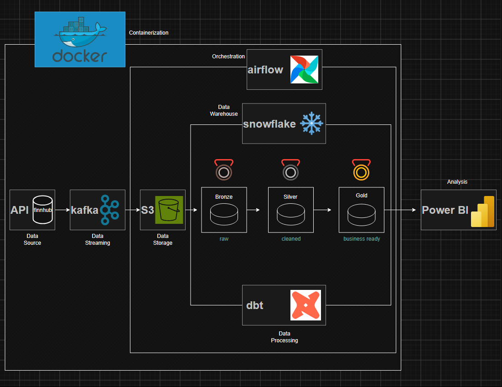

# Near-Real-Time Stock Market Data Pipeline

An end-to-end data pipeline that streams live stock quotes from the Finnhub API through Kafka, lands them in MinIO object storage, loads them into Snowflake with Airflow, transforms them with dbt into a bronze / silver / gold model, and serves a Power BI dashboard.

**Tickers tracked:** TSLA, NVDA, TSM, CME, and SPY (S&P 500 ETF, used as a market benchmark).


*[View the full dashboard as a PDF](docs/dashboard.pdf)*

---

## Architecture



| Layer | Tool | Role |
|---|---|---|
| Ingestion | Python, `requests` | Polls Finnhub for quotes |
| Streaming | Kafka (+ Zookeeper, Kafdrop UI) | Buffers quotes between producer and consumer |
| Raw storage | MinIO (S3-compatible) | Stores every quote as a JSON file |
| Orchestration | Apache Airflow | Loads new files from MinIO into Snowflake on a schedule |
| Warehouse | Snowflake | Stores raw and modelled data |
| Transformation | dbt | Cleans and models data; data tests |
| Visualization | Power BI | KPIs, candlesticks, volatility and risk views |
| Infrastructure | Docker Compose | Runs Kafka, MinIO, Airflow and their databases locally |

---

## How the data flows

1. **Producer** (`producer.py`) polls Finnhub's `/quote` endpoint for each ticker. It skips invalid quotes (price of 0) and repeated quotes with an unchanged market timestamp (the market is closed), then publishes the rest to the Kafka topic `stock-quotes`, keyed by ticker.
2. **Consumer** (`consumer.py`) reads from Kafka and writes each quote to MinIO as `SYMBOL/YYYY-MM-DD/SYMBOL_<timestamp>.json`.
3. **Airflow DAG** downloads the files from MinIO, uploads them to the Snowflake table stage with `PUT`, and loads them into the bronze table with `COPY INTO`.
4. **dbt** parses the raw JSON (staging), cleans and rounds it (silver), and builds analysis-ready views (gold).
5. **Power BI** reads the gold views.

---

## Data model

| Layer | Model | Description |
|---|---|---|
| Bronze | `bronze_stock_quotes_raw` | Raw JSON quotes in one `VARIANT` column, exactly as received |
| Staging | `stg_bronze_stock_quotes` | JSON fields extracted into typed columns; Unix timestamps converted |
| Silver | `silver_clean_stock_quotes` | Invalid rows removed, prices rounded |
| Gold | `gold_kpi_view` | Latest price, change and % change per ticker |
| Gold | `gold_volatility_view` | Latest-day average price, volatility and relative volatility per ticker |
| Gold | `gold_candle_view` | Last 12 hourly candles per ticker (open, high, low, close, trend line) |

**Finnhub field mapping**

| JSON field | Column | Meaning |
|---|---|---|
| `symbol` | `ticker` | Stock symbol |
| `c` | `current_price` | Current price |
| `d` | `price_change` | Change vs. previous close |
| `dp` | `percent_change` | Percent change |
| `h` / `l` / `o` | `day_high` / `day_low` / `day_open` | Day range and open |
| `pc` | `prev_close` | Previous close |
| `t` | `market_timestamp` | Market timestamp (Unix seconds) |
| `fetched_at` | `fetched_at` | When the producer fetched it (added by the producer) |

---

## Reliability and design decisions

**Producer**
- The API key is sent in a request header, not the URL, so it never appears in logs.
- Requests have a 10-second timeout, and rate-limit (HTTP 429) responses are handled.
- Duplicate filtering: a quote is only sent when its market timestamp `t` changes, so the market being closed doesn't create thousands of identical rows.
- Kafka writes use `acks="all"` and retries; messages are keyed by ticker so each ticker's quotes stay in order.
- On shutdown, buffered messages are flushed before exiting.

**Consumer: at-least-once delivery with idempotent writes**
- Kafka offsets are committed only **after** a file is successfully written to MinIO, so a crash never loses a message.
- File names are built from the ticker and market timestamp, so reprocessing a message overwrites the same file instead of creating a duplicate.
- Malformed messages are logged and skipped instead of crashing the consumer.
- MinIO writes retry automatically; the bucket is created if it doesn't exist.

**Loading**
- Snowflake's `COPY INTO` tracks which files have already been loaded, so re-running the DAG never duplicates rows.
- Airflow passes the list of downloaded files between tasks with XCom.

**Why micro-batch rather than true streaming?** Quotes stream through Kafka in near real time, but loading into Snowflake runs on a schedule. This keeps the warehouse cheaper (it can suspend between runs) and is more than fresh enough for hourly candles.

---

## Data quality

dbt's built-in data tests run on every layer:

| Layer | Tests |
|---|---|
| Bronze | Raw JSON is never null |
| Staging / silver | Ticker, price and timestamps are never null; tickers are only the five tracked symbols |
| Gold | Exactly one row per ticker in the KPI and volatility views; every KPI ticker exists in silver; candles always have a ticker and time |

Run them with `dbt test`, or `dbt build` to build the models and test them in order.

---

## Project structure

```
portfolio-pipeline/
├── docker-compose.yml             # Kafka, Zookeeper, Kafdrop, MinIO, Airflow
├── dockerfile-airflow.dockerfile  # Airflow image + Python dependencies
├── .env.example                   # Environment variable template (copy to .env)
├── producer.py                    # Finnhub → Kafka
├── consumer.py                    # Kafka → MinIO
├── dags/
│   └── minio_to_snowflake.py      # MinIO → Snowflake (Airflow DAG)
└── portfolio_dbt/
    ├── dbt_project.yml
    ├── profiles.yml               # reads credentials from environment variables
    └── models/
        ├── bronze/                # source, staging model + tests
        ├── silver/                # cleaned quotes + tests
        └── gold-marts/            # KPI, volatility, candle views + tests
```

---

## Getting started

### Prerequisites
- Docker Desktop
- Python 3.10–3.12
- A free [Finnhub](https://finnhub.io) API key
- A Snowflake account (the free trial works)

### 1. Configure environment variables
```bash
cp .env.example .env
```
Fill in `.env`:
```env
# Finnhub
FINNHUB_API_KEY=

# Kafka (from your PC)
KAFKA_BOOTSTRAP=localhost:29092
KAFKA_TOPIC=stock-quotes

# MinIO
MINIO_ROOT_USER=
MINIO_ROOT_PASSWORD=
MINIO_ENDPOINT=http://minio:9000          # used by Airflow (inside Docker)
MINIO_ENDPOINT_LOCAL=http://localhost:9000 # used by consumer.py (on your PC)
MINIO_BUCKET=bronzestock

# Snowflake
SNOWFLAKE_ACCOUNT=
SNOWFLAKE_USER=
SNOWFLAKE_PASSWORD=
SNOWFLAKE_WAREHOUSE=
SNOWFLAKE_DB=
SNOWFLAKE_SCHEMA=

# Airflow
AIRFLOW_DB_USER=
AIRFLOW_DB_PASSWORD=
AIRFLOW_DB_NAME=
AIRFLOW_SECRET_KEY=
AIRFLOW_ADMIN_USER=
AIRFLOW_ADMIN_PASSWORD=
```

### 2. Create the Snowflake table
```sql
CREATE TABLE IF NOT EXISTS <DB>.<SCHEMA>.bronze_stock_quotes_raw (v VARIANT);
```

### 3. Start the infrastructure
```bash
docker compose up -d --build
```

| Service | URL |
|---|---|
| Airflow | http://localhost:8080 |
| MinIO console | http://localhost:9001 |
| Kafdrop (Kafka UI) | http://localhost:9002 |

### 4. Run the producer and consumer
```bash
python -m venv venv
venv\Scripts\activate            # Windows  (macOS/Linux: source venv/bin/activate)
pip install kafka-python requests boto3 python-dotenv

python producer.py               # terminal 1
python consumer.py               # terminal 2
```

### 5. Turn on the Airflow DAG
In the Airflow UI, unpause `minio_to_snowflake`.

### 6. Build and test the dbt models
```bash
cd portfolio_dbt
pip install dbt-snowflake
dbt build                        # runs models and tests
```

---

## Challenges and what I learned

- **Docker networking.** Containers can't reach each other through `localhost`; they use service names (`minio:9000`, `kafka:9092`). Kafka needed two listeners: one advertised to containers and one to the host machine.
- **Environment variables in Docker.** Airflow couldn't see `.env` until it was passed in with `env_file`. Containers have to be recreated (`down` / `up`), not just restarted, to pick up changes.
- **Snowflake authentication.** Repeated failed logins from a DAG scheduled every minute locked the account. I learned to test the connection once by hand, pause the DAG while debugging, and use `LOGIN_HISTORY` to find the real cause.
- **After-hours duplicates.** Finnhub repeats the same market timestamp when the market is closed, which inflated row counts and distorted candles. Fixed at the source by filtering duplicates in the producer.
- **Ticker spelling mistake.** Wrote the wrong ticker symbol and the API returned null values, fix or added data quality checks for nulls using dbt tests.
- **Silent data loss risks.** Auto-committing Kafka offsets could lose messages if a write failed, and non-unique file names could overwrite each other. Fixed with manual commits and deterministic, ticker-specific file names.

---

## Limitations and next steps

- [ ] Incremental loading: track a high-watermark so each DAG run processes only new files instead of the whole bucket
- [ ] Incremental silver model in dbt
- [ ] Run `dbt build` from Airflow after each load
- [ ] Benchmark each stock against SPY (relative return, beta, correlation)
- [ ] Add a second data source (company news or earnings dates)
- [ ] Alerts on large price moves or failed tests
- [ ] CI with GitHub Actions (`dbt compile` and unit tests on every push)

---

## Author

Nathaniel Choi · [LinkedIn](https://www.linkedin.com/in/nathaniel-choi/)
